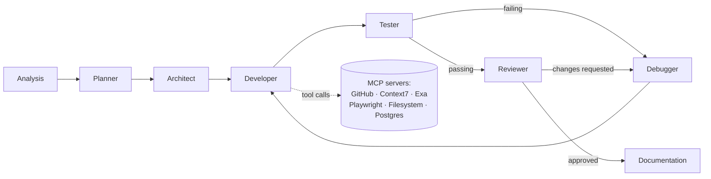

<div align="center">

# AgentForge

**AI software engineering, run end to end by a supervised multi-agent pipeline.**

[](LICENSE)
[](pyproject.toml)
[](frontend/package.json)
[](backend/api/app.py)
[](docs/System_Architecture.md)

[**Live App**](https://frontend-naman-213.vercel.app) &nbsp;·&nbsp; [**API**](https://agentforge.fastapicloud.dev) &nbsp;·&nbsp; [**Docs**](docs/System_Architecture.md)

</div>

---

## Contents

- [What it does](#what-it-does)
- [Why it's built this way](#why-its-built-this-way)
- [Architecture](#architecture)
- [Tech stack](#tech-stack)
- [Getting started](#getting-started)
- [Configuration](#configuration)
- [Docker](#docker)
- [Testing](#testing)
- [Project structure](#project-structure)
- [Documentation](#documentation)
- [License](#license)

## What it does

You describe a project (requirements, tech stack, constraints), and AgentForge takes it from there. A [LangGraph](https://github.com/langchain-ai/langgraph) state graph routes the request through a pipeline of specialized agents that analyze, plan, architect, implement, test, debug, review, and document the result, writing real files to a workspace directory as it goes. Every step streams live to the frontend over Server-Sent Events: agent status, file diffs, test output, review findings.

## Why it's built this way

- **Evidence over self-report.** LLM output is only ever treated as fact once the system has independently verified it: the Tester agent reasons over real `pytest` exit codes and captured output, never a model's claim that "tests pass."
- **Every agent has one job.** Analysis doesn't design architecture; the Developer doesn't grade its own code. Narrow scopes keep each agent's context focused and its output easier to verify.
- **Full traceability.** Every agent call, tool invocation, and state transition is a traced, resumable execution, not a black-box chat completion, with checkpointing so a run can recover from a mid-pipeline failure instead of restarting.
- **Tools, not just tokens.** An [MCP](https://modelcontextprotocol.io/) client layer gives agents scoped, permissioned access to real external tools (GitHub, live framework docs, web research, a sandboxed filesystem, database introspection) rather than relying on model knowledge alone.

## Architecture

An 8-agent pipeline orchestrated as a LangGraph state graph, each agent scoped to one responsibility:

| Agent | Responsibility |
|---|---|
| **Analysis** | Turns the raw request into confirmed requirements, asking clarifying questions where needed |
| **Planner** | Breaks confirmed requirements into an ordered implementation plan with milestones and risks |
| **Architect** | Designs the technical architecture (routes, schemas, components) from the plan |
| **Developer** | Writes the actual implementation against the approved architecture |
| **Tester** | Analyzes real test execution evidence to distinguish application bugs from bad generated tests |
| **Debugger** | Root-causes test failures or review feedback and briefs the Developer on the fix |
| **Reviewer** | Evidence-based code review: correctness, security, architecture compliance, quality |
| **Documentation** | Generates README, API, architecture, installation, and deployment docs from the verified implementation |



Every step emits events over SSE, consumed live by the frontend workspace. Full internals: [System Architecture](docs/System_Architecture.md), [Agent Design](docs/Agent_Design.md), [MCP Integration](docs/MCP_Integration.md).

## Tech stack

| Layer | Stack |
|---|---|
| **Backend** | FastAPI · LangGraph · LangChain (Anthropic, Mistral, Google, Groq, Cerebras, OpenRouter, Perplexity, Z.AI) · SQLAlchemy + Alembic · PostgreSQL · JWT auth · MCP (`fastmcp`) · Server-Sent Events · LangSmith tracing |
| **Frontend** | Next.js 16 (App Router, Turbopack) · React 19 · Tailwind CSS v4 · Radix UI · TanStack Query · Monaco Editor · `react-markdown` |
| **Deployment** | Dockerized backend (multi-stage build, Node.js runtime for MCP servers), deployable anywhere; currently on FastAPI Cloud. Frontend on Vercel. |

## Getting started

### Prerequisites

- Python 3.11+
- Node.js, for the frontend and for the `npx`-based MCP servers the backend spawns
- PostgreSQL (optional; the app runs without a database, with persistence-dependent features disabled)

### Backend

```powershell
git clone https://github.com/sarvadnya2030/AgentForge-multi-agent.git
cd AgentForge-main
python -m venv .venv
.\.venv\Scripts\Activate.ps1
pip install -r requirements.txt
copy .env.example .env
uvicorn backend.api.app:app --reload
```

API served at `http://127.0.0.1:8000`; interactive docs at `/docs`.

### Frontend

```powershell
cd frontend
npm install
copy .env.example .env.local
npm run dev
```

Served at `http://localhost:3000`.

### CLI

The backend also ships an `agentforge` CLI (`pip install -e .`) for running and inspecting workflows without the API: creating and resuming runs, checking status, replaying history, and managing MCP servers.

```bash
agentforge create "Build a task management API with FastAPI and PostgreSQL"
agentforge status <run-id>
agentforge mcp list
```

## Configuration

All configuration is via environment variables; see [.env.example](.env.example) for the full list: LLM provider keys (only the ones you intend to use are required), `DATABASE_URL`, `JWT_SECRET`, `API_CORS_ORIGINS`, LangSmith tracing, and MCP server credentials (`GITHUB_MCP_TOKEN`, `CONTEXT7_API_KEY`, `EXA_API_KEY`). Nothing is hardcoded: secrets are read only from the environment.

## Docker

A production Dockerfile is included for the backend (the frontend is deployed separately):

```bash
docker build -t agentforge-backend .
docker run -p 8000:8000 --env-file .env agentforge-backend
```

The image installs Node.js alongside Python so `npx`-based MCP servers can run inside the container, and creates the `workspace/`, `.agentforge/`, and `logs/` directories the app writes to at runtime; mount these as volumes in production to persist generated projects and run history across container restarts.

## Testing

```bash
pytest
```

949 tests covering agents, services, API routes, MCP integration, and the workflow graph.

```bash
cd frontend && npx tsc --noEmit && npm run build
```

## Project structure

```
backend/
  agents/        agent implementations (analysis, planner, architect, ...)
  api/           FastAPI app, routers, request/response schemas
  core/          app wiring, config, workspace paths
  graph/         LangGraph workflow builder and nodes
  mcp/           MCP client manager, config, permissions, tool registry
  services/      testing, review, documentation, dependency-prep, etc.
  state/         Pydantic state models shared across the graph
  db/            SQLAlchemy models
  prompts/       per-agent system prompts
frontend/
  src/app/         Next.js routes
  src/components/  workspace, chat, repo explorer, run visualization
  src/hooks/       shared SSE connection, persisted state, etc.
docs/              architecture, API design, MCP integration, roadmap
tests/             backend test suite
```

## Documentation

| Doc | Covers |
|---|---|
| [System Architecture](docs/System_Architecture.md) | End-to-end system design |
| [Agent Design](docs/Agent_Design.md) | Per-agent responsibilities and prompting |
| [API Design](docs/API_Design.md) | REST + SSE API surface |
| [MCP Integration](docs/MCP_Integration.md) | MCP client layer, servers, permissions |
| [Deployment](docs/Deployment.md) | Docker, FastAPI Cloud, Vercel, CORS |
| [Database Design](docs/Database_Design.md) | Schema and persistence model |
| [Frontend Design](docs/Frontend_Design.md) | Workspace UI architecture |
| [State Management](docs/State_Management.md) | LangGraph state schemas |
| [Project Vision](docs/Project_Vision.md) | Product direction |
| [Development Roadmap](docs/Development_Roadmap.md) | Planned work |
| [Future Improvements](docs/Future_Improvements.md) | Known gaps and next steps |

## License

MIT. See [LICENSE](LICENSE).
